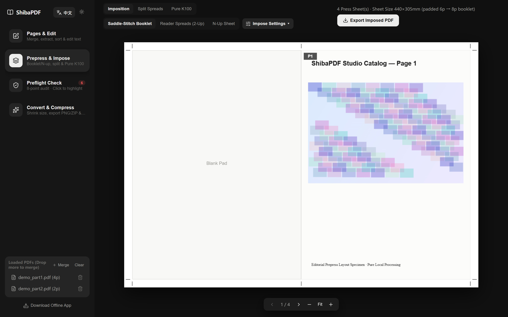
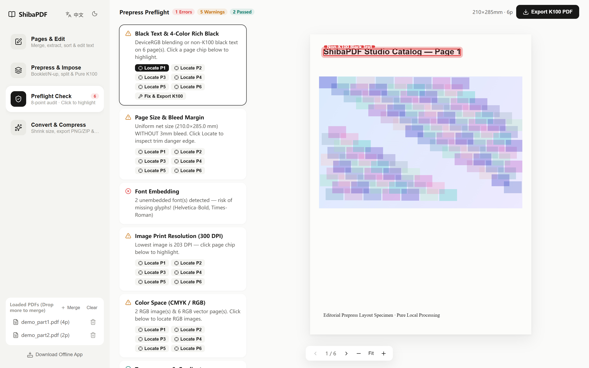

<div align="center">

# ShibaPDF

**Minimalist Client-Side PDF Studio: Merge & Extract, Zero-Shift Text Editor, Print Imposition, Visual Preflight, Image/ZIP Export & Smart Compression**

*100% Local in Your Browser · Zero Server Uploads · Preserves Vectors, Gradients & Live Transparency*

🌐 **[Live Online App: wonvy.github.io/ShibaPDF](https://wonvy.github.io/ShibaPDF/)** · **English** | [简体中文](./README.zh-CN.md)

</div>

---


## Overview

**ShibaPDF** is a borderless, progressive single-file PDF workbench built for designers, editors, and print production workflows. Everything runs 100% locally in browser memory with minimalist Light/Dark custom scrollbars and smooth **`Ctrl + Scroll Wheel`** canvas zooming across four focused pillars:

1. **Pages & Edit (`Pages & Edit`)**
   - **Merge, Multi-Select & Extract**: Drop multiple PDFs to merge into one workspace, drag-and-drop thumbnails to reorder, rotate/delete selected pages, or **extract selected pages** directly as a new PDF or PNG/ZIP archive.
   - **Zero-Shift In-Place Text Editor**: Click any existing PDF text to edit in-place with exact font ascent/baseline matching, automatic ink & background mask color sampling, font family picker (`Sans / Serif / Kai / Mono`), and dynamic pointer feedback (`grab`, `grabbing`, `text`, `nwse-resize`, `ew-resize`, `crosshair`).
2. **Prepress & Impose (`Prepress & Impose`)**
   - **Print Imposition (`Imposition`)**: Build **Saddle-Stitch Booklets** (auto `4P` signature padding & front/back pairing), **2-Up Reader Spreads**, or **N-Up Press Sheets (`2/4/8-Up`)** on Auto, `SRA3`, `A3`, `4-Kai Large`, or `4-Kai Standard` sheets with vector **Pure `K100` crop marks**.
   - **Spread Splitter (`Split Spreads`) & Pure `K100` Fix**: Losslessly slice double-page spreads into single pages with outer bleed trimming and automatic `[Back Cover | Front Cover]` reordering, or convert 4-color rich black text to **Pure CMYK Black (`C0 M0 Y0 K100`)** while keeping live soft-mask shadows.
3. **Visual Prepress Preflight (`Preflight Check`)**
   - Runs an 8-point print-ready audit (4-color black, bleed margins, font embedding, effective printed image DPI, RGB/CMYK color spaces, transparency, 4P booklet multiple, encryption) and **jumps directly to offending text, images, or edges with pulsing red spotlight highlights on the canvas**.
4. **Convert & Compress (`Convert & Compress`)**
   - **Smart PDF Size Reducer**: Downsamples oversized embedded bitmaps (`220 / 150 / 100 DPI`) while preserving sharp vector text, or performs extreme full-page compression.
   - **Export High-Res Images & ZIP**: Render all or selected pages at `150 / 300 / 600 DPI` (`PNG` or `JPG`), automatically bundling multi-page exports into a zero-dependency `.zip` archive.
   - **Image-Only PDF (Anti-Copy / Font Lock)**: Rasterizes pages into a tamper-resistant, font-locked PDF so layouts never break on any device.

---

## Screenshots

### Saddle-Stitch & N-Up Press Sheet Imposition (Dark Theme)


### Interactive Prepress Preflight & Canvas Spotlight Locator


### Progressive Spread Splitter & Bleed Cut Guides


---

## Quick Start

### Option 1: Use Online or Download Standalone Offline HTML (Zero Install)
- **Online**: Visit **[wonvy.github.io/ShibaPDF](https://wonvy.github.io/ShibaPDF/)** directly in your browser.
- **Offline Single-File**: Click **"Download Offline App"** at the bottom-left of the app (or download **[`index.html`](https://raw.githubusercontent.com/Wonvy/ShibaPDF/main/index.html)**) to save `ShibaPDF_Offline_Studio.html` — works 100% offline on Windows, macOS, and Linux with a simple double-click.

### Option 2: Build from Source
If you modify files under `src/`, rebuild the standalone single-file `index.html`:

```bash
npm install
npm run build
```

---

## Project Structure

```text
ShibaPDF/
├── index.html                        # Standalone single-file web app (offline & GitHub Pages ready)
├── src/
│   ├── template.html                 # 4-pillar borderless layout & Lucide icon bindings
│   ├── styles.css                    # Minimalist Light/Dark theme, custom scrollbars & cursor states
│   ├── i18n.js                       # Bilingual English / 简体中文 dictionary
│   ├── zip.js                        # Zero-dependency CRC32 .zip archive builder
│   ├── prepress-k100.js              # Pure K100 stream rewriter, font baseline analyzer & 8-point preflight
│   ├── imposition.js                 # Saddle-stitch booklet, 2-Up & N-Up vector imposition + K100 crop marks
│   ├── convert-compress.js           # PNG/JPG/ZIP exporter, image-only PDF & vector-safe size reducer
│   └── app.js                        # Unified multi-PDF workspace & progressive UI controller
├── scripts/
│   └── build.js                      # Single-file compiler (inlines CSS, Lucide SVGs & PDF engines)
├── docs/images/                      # Retina UI documentation screenshots
└── .github/workflows/deploy-pages.yml # Automated GitHub Pages deployment
```

---

## License

Released under the **MIT License**. Built with [pdf-lib](https://pdf-lib.js.org/), [PDF.js](https://mozilla.github.io/pdf.js/), and [Lucide Icons](https://lucide.dev/).
