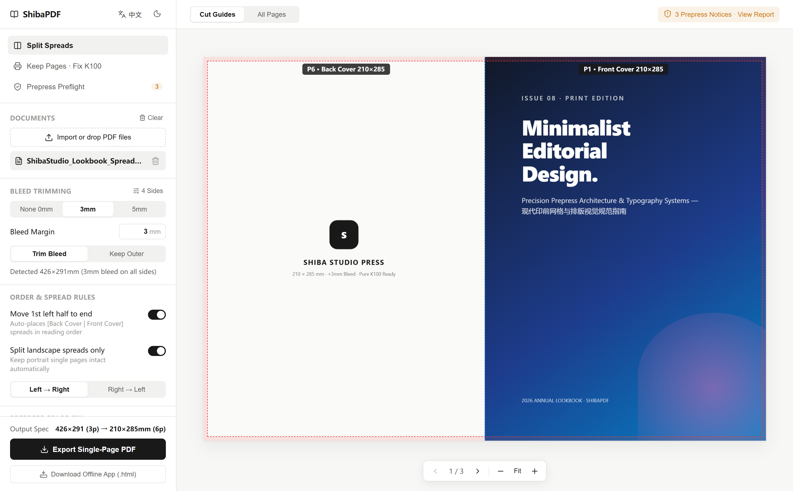
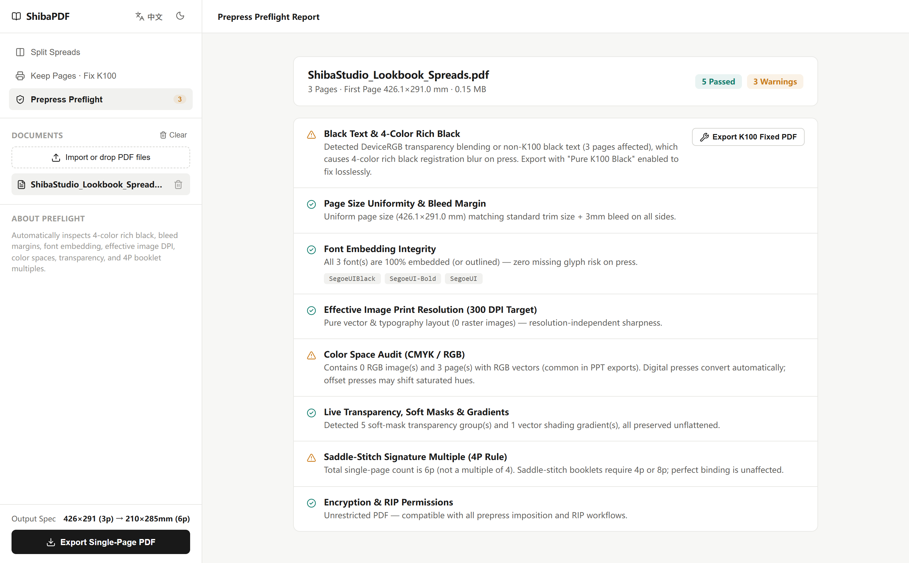
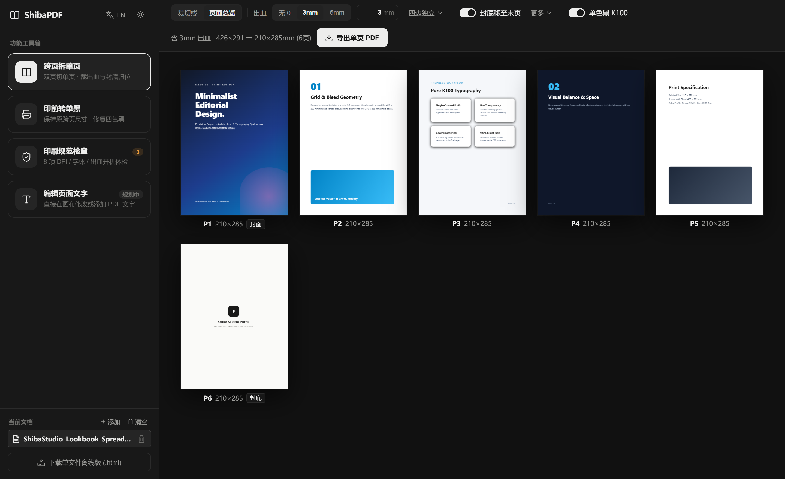

<div align="center">

# ShibaPDF

**Lossless PDF Spread Splitter, Pure K100 Prepress Fixer & Print Preflight Inspector**

*100% Client-Side in Your Browser · Zero Server Uploads · Preserves Vectors, Gradients & Live Transparency*

🌐 **[Live Online App: wonvy.github.io/ShibaPDF](https://wonvy.github.io/ShibaPDF/)** · **English** | [简体中文](./README.zh-CN.md)

</div>

---



## Overview

**ShibaPDF** is a lightweight, zero-dependency single-file web studio designed for graphic designers, print production teams, and brochure creators. It solves two critical workflows without requiring Adobe Acrobat or uploading confidential files to third-party servers:

1. **Reader's Digital Edition (`Split Spreads`)** — Losslessly slices double-page spreads into single pages, trims outer bleed margins (e.g., `426 × 291 mm` ➜ `210 × 285 mm`), and automatically reorders booklet `[Back Cover | Front Cover]` spreads so Front Cover lands on Page 1 and Back Cover moves to the final page.
2. **Press-Ready Factory Edition (`Keep Pages · Fix K100`)** — Preserves 100% of original spread dimensions, bleed margins, and page order while rewriting black/gray text & strokes to **single-channel Pure CMYK Black (`C0 M0 Y0 K100`)** and switching page transparency blending from `/DeviceRGB` to `/DeviceCMYK` (`PDF/X-4` standard) without flattening live shadows or gradients.

---

## Key Features

- **8-Point Prepress Preflight Inspector**:
  - **4-Color Rich Black Detection**: Identifies `/DeviceRGB` transparency blending groups (common in PowerPoint/Office PDFs) and non-K100 black text that cause press registration blur, with **1-click K100 auto-fix**.
  - **Bleed & Page Size Uniformity**: Detects mixed page sizes and distinguishes net trim sizes (`0mm` bleed) from bleed-included spreads (`+3mm` / `+5mm`).
  - **Font Embedding Integrity**: Inspects Type0/CID and standard font descriptors across all pages to flag unembedded fonts before sending to RIP.
  - **Effective Print Image DPI**: Tracks PDF Current Transformation Matrices (`CTM`) to compute the **actual printed DPI** of every placed bitmap against the `300 DPI` print benchmark.
  - **Color Space, Live Transparency, Saddle-Stitch `4P` Rule & Encryption Checks**.
- **Flexible Bleed Geometry**: Quick presets (`0mm`, `3mm`, `5mm`), uniform 4-side or independent `Top / Bottom / Left / Right` margins, and optional `TrimBox` metadata retention.
- **Zero File-Size Bloat**: Shares underlying XObject images, fonts, and color profiles across split pages.
- **Minimalist Two-Column Studio UI**: Built with open-source [Lucide Icons](https://lucide.dev/), supporting **Light / Dark** themes and instant **English / 中文** switching.

---

## Screenshots

### Prepress Preflight Inspection Report


### Dark Theme & Split Single-Page Sequence Gallery


---

## Quick Start

### Option 1: Use Online or Download Standalone Offline HTML (Zero Install)
- **Online**: Visit **[wonvy.github.io/ShibaPDF](https://wonvy.github.io/ShibaPDF/)** directly in your browser.
- **Offline Single-File**: Click **"Download Offline App (.html)"** at the bottom-left of the app (or download **[`index.html`](https://raw.githubusercontent.com/Wonvy/ShibaPDF/main/index.html)**) to save `ShibaPDF.html` to your computer — works 100% offline on Windows, macOS, and Linux with a simple double-click.

### Option 2: Build from Source
If you modify files under `src/`, rebuild the standalone single-file `index.html`:

```bash
npm install
npm run build
```

---

## Project Structure

```text
ShibaPDF/
├── index.html                        # Standalone bundled web app (offline & GitHub Pages ready)
├── src/
│   ├── template.html                 # Two-column layout & Lucide icon bindings
│   ├── styles.css                    # Minimalist Light & Dark theme system
│   └── app.js                        # Spread splitter, K100 stream rewriter & Preflight engine
├── scripts/
│   └── build.js                      # Single-file compiler (inlines CSS, Lucide SVGs & PDF engines)
├── docs/images/                      # UI documentation screenshots
└── .github/workflows/deploy-pages.yml # Automated GitHub Pages deployment
```

---

## License

Released under the **MIT License**. Built with [pdf-lib](https://pdf-lib.js.org/), [PDF.js](https://mozilla.github.io/pdf.js/), and [Lucide Icons](https://lucide.dev/).
