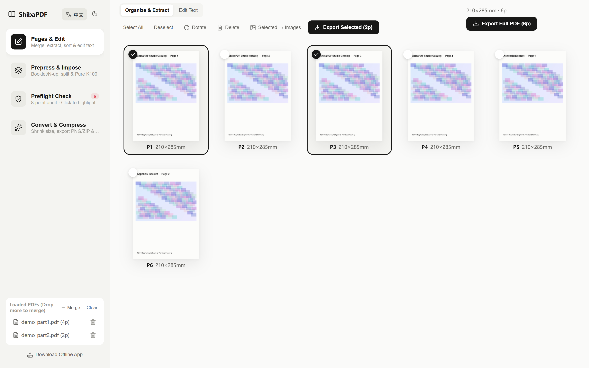
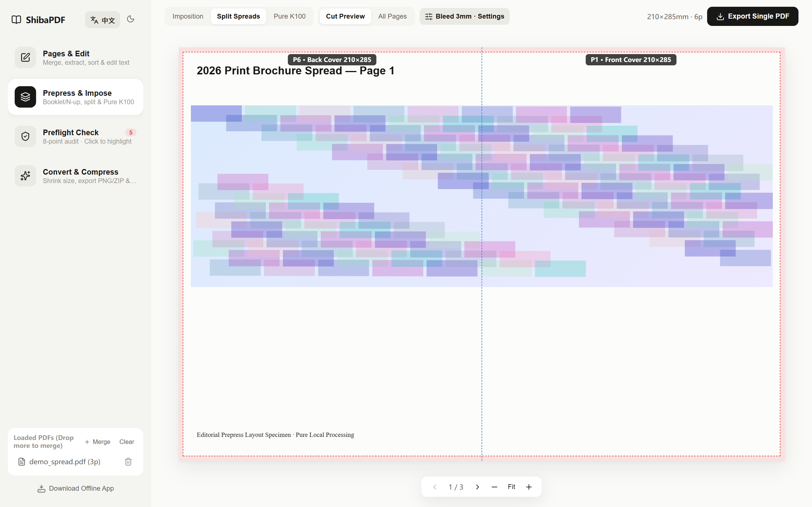

<div align="center">

# ShibaPDF

**极简纯本地全能 PDF 与印前工作台：多文档合并选页提取、零偏移原位改字、骑马钉/多联拼版、印前定位体检、导图片与智能体积压缩**

*100% 浏览器本地运行 · 零服务器上传 · 亮暗极简滚动条 · Ctrl + 滚轮丝滑画布缩放*

🌐 **[在线直接使用：wonvy.github.io/ShibaPDF](https://wonvy.github.io/ShibaPDF/)** · [English](./README.md) | **简体中文**

</div>

---



## 项目简介

**ShibaPDF** 是一款无边框极简风格、渐进式交互的单文件 PDF 工作台。无需安装庞大桌面软件，所有操作 100% 在本地浏览器内存中完成，围绕设计定稿、印刷拼版与日常办公划分四大核心模块：

1. **页面与编辑（`页面与编辑`）**
   - **多 PDF 合并、拖拽排序与单独导出所选页**：支持一次或分批拖入多个 PDF 自动合并，按住缩略图即可拖拽调序，勾选任意页面即可触发**「单独导出所选页 PDF」**或**「所选页导图片」**。
   - **零偏移原位文字编辑**：精准读取 PDF 字体基线（`ascent`）并自动吸取原文字色与背景遮罩色，支持**黑体 / 宋体 / 楷体 / 等宽**字体切换，配备专属移动手柄与角点缩放控制点及完整动态鼠标指针反馈（`grab` / `grabbing` / `text` / `nwse-resize` / `ew-resize` / `crosshair`）。
2. **印前与拼版（`印前与拼版`）**
   - **专业印刷拼版（`印刷拼版`）**：支持 **骑马钉画册折手**（自动补齐 `4` 的倍数并按正反折手对拼）、**单页合跨页（`2-Up`）** 以及 **多联拼版（`2/4/8拼`，含自动尺寸、`SRA3`、`A3`、`大度四开`、`正度四开`）**，自动生成矢量 **单色黑 `K100` 标准裁切角线**。
   - **跨页拆单页与印前单黑修复**：无损将双页画册切分为单页、裁除四周出血并将首张封底移至末页；一键将四色黑文字无损重写为纯单黑 `C0 M0 Y0 K100` 并保留半透明阴影与矢量渐变。
3. **印前规范检查（`印前检查`）**
   - 自动执行 8 项开机印刷体检（四色黑、出血位、字体嵌入、图片真实印刷 DPI、CMYK/RGB 色彩空间、透明度、骑马钉 `4P` 模数、加密锁），**点击页码芯片即可跳转到对应页面并在画布上红框脉冲高亮标出具体风险区域**。
4. **转换与压缩（`转换与压缩`）**
   - **智能减小 PDF 体积**：支持 `220 / 150 / 100 DPI` 三档瘦身，优先保留矢量文字锐利度并对内嵌大图智能重编码，直观展示压缩前后体积对比。
   - **导出高清图片（自动打包 `.zip`）**：支持 `150 / 300 / 600 DPI` 导出 `PNG` 或 `JPG`，多页导出自动零依赖打包为 `.zip`。
   - **转为纯图片版 PDF（防篡改 / 锁死字体）**：将每页栅格化封装为纯图像 PDF，彻底防止外部复制篡改文字并杜绝缺字乱码。

---

## 界面预览

### 骑马钉与多联大版印刷拼版（深色主题）


### 印前规范体检与画布红框定位高亮


### 渐进式跨页裁切与出血辅助线预览


---

## 快速开始

### 方式一：在线访问或一键下载单文件离线版（免安装）
- **在线使用**：直接访问 **[wonvy.github.io/ShibaPDF](https://wonvy.github.io/ShibaPDF/)**。
- **离线单文件**：点击界面左下角的 **「下载单文件离线版」** 按钮（或直接下载仓库根目录 **[`index.html`](https://raw.githubusercontent.com/Wonvy/ShibaPDF/main/index.html)**），即可将 `ShibaPDF_Offline_Studio.html` 保存到本地电脑，断网双击即可永久使用。

### 方式二：修改源码并重新打包
若修改了 `src/` 目录下的模块化源码，运行以下命令即可重新构建单文件 `index.html`：

```bash
npm install
npm run build
```

---

## 目录结构

```text
ShibaPDF/
├── index.html                        # 打包后的独立单文件网页应用（离线可用 / GitHub Pages 直出）
├── src/
│   ├── template.html                 # 四大模块无边框布局与 Lucide 图标模板
│   ├── styles.css                    # 亮/暗双主题、极简滚动条与动态指针样式
│   ├── i18n.js                       # 中英双语词典
│   ├── zip.js                        # 零依赖 CRC32 多图自动打包 .zip 引擎
│   ├── prepress-k100.js              # K100 色彩指令重写、字体基线解析与 8 项印前预检
│   ├── imposition.js                 # 骑马钉折手、单页合跨页、N拼大版与 K100 裁切角线引擎
│   ├── convert-compress.js           # 高清导图、纯图版防篡改 PDF 与智能体积压缩引擎
│   └── app.js                        # 统一多文档工作区与渐进式交互主控制器
├── scripts/
│   └── build.js                      # 单文件内联打包脚本
├── docs/images/                      # 文档高清配图
└── .github/workflows/deploy-pages.yml # GitHub Pages 自动部署工作流
```

---

## 开源协议

基于 **MIT License** 开源。致谢 [pdf-lib](https://pdf-lib.js.org/)、[PDF.js](https://mozilla.github.io/pdf.js/) 与 [Lucide Icons](https://lucide.dev/)。
