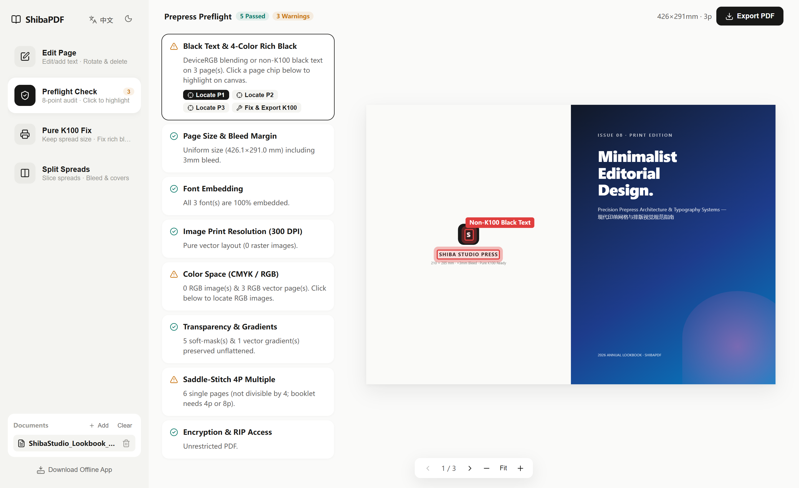
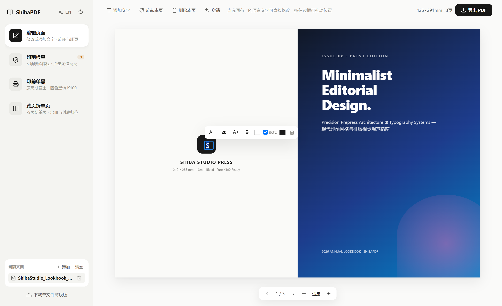
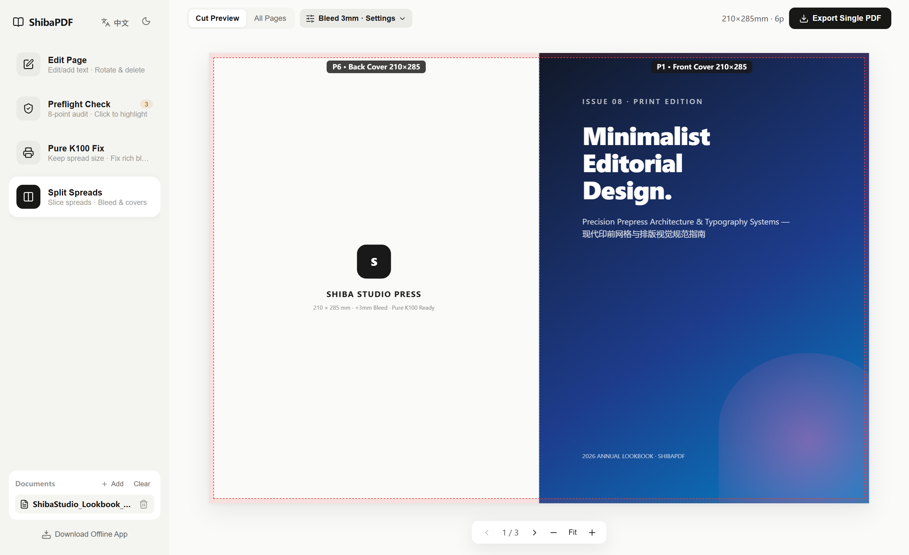
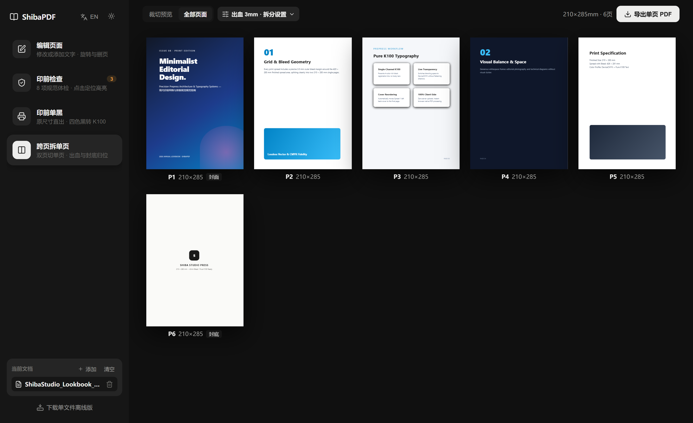

<div align="center">

# ShibaPDF

**极简纯本地 PDF 编辑与印前工作台：页面文字编辑、印前检查定位高亮、四色黑转单黑 (K100) 与跨页拆分**

*100% 浏览器本地运行 · 零服务器上传 · 支持 Ctrl + 滚轮丝滑画布缩放*

🌐 **[在线直接使用：wonvy.github.io/ShibaPDF](https://wonvy.github.io/ShibaPDF/)** · [English](./README.md) | **简体中文**

</div>

---



## 项目简介

**ShibaPDF** 是一款无边框极简风格、渐进式交互的单文件 PDF 工具箱。无需安装 Adobe Acrobat，全程在本地浏览器运行，覆盖设计定稿与印前交付四大核心场景：

1. **编辑页面（`编辑页面`）** —— 直接点击页面上的原有文字即可原位修改（自动吸取底色遮盖与字色匹配）、自由添加与拖动中英文新文字，支持单页旋转、删除与多步撤销。
2. **印前规范检查（`印前检查`）** —— 自动执行 8 项开机规范体检（四色黑、出血位、字体嵌入、图片真实印刷 DPI、CMYK/RGB 色彩空间、透明度、骑马钉 `4P` 模数、加密锁），**点击问题页码即可直接跳转到对应页面并在画布上红框高亮标出出错位置**。
3. **印前单黑修复（`印前单黑`）** —— 保持原跨页尺寸与出血 100% 不变，将黑/灰文字与线条无损改写为纯单黑 `C0 M0 Y0 K100`，并将透明混合空间改为 `/DeviceCMYK`，保留全部半透明阴影与矢量渐变。
4. **跨页拆单页（`跨页拆单页`）** —— 渐进式收纳拆分参数，无损将双页切为单页、裁除四周出血并自动将首张封底移至末页。

---

## 核心功能

- **8 项印刷规范自动预检（Preflight）**：
  - **四色黑与单黑文字检测**：识别 `/DeviceRGB` 透明混合空间及非单黑文字隐患，支持**一键导出 K100 修复版**。
  - **页面尺寸一致性与出血位检测**：自动识别混排异形页，区分净尺寸无出血稿件（`0mm`）与标准含出血稿件（`3mm` / `5mm`）。
  - **字体嵌入完整性检测**：深度扫描全书普通字体与中文字体子集描述符，提前预警未嵌入字体引发的乱码缺字。
  - **图片真实印刷分辨率 (DPI) 检测**：通过追踪 PDF 矩阵变换（`CTM`）计算每张位图在纸面上的**真实有效印刷 DPI**（对照 `300 DPI` 印刷标准预警低清图）。
  - **色彩空间审计（CMYK / RGB）、原生透明度与渐变检测、骑马钉 `4P` 页数模数检验、RIP 加密锁检测**。
- **灵活出血控制**：支持 `无 0mm` / `3mm` / `5mm` 快捷预设，支持四边统一或**上、下、左、右独立微调**，可选裁除出血或保留外出血并写入 `TrimBox`。
- **底层共享不膨胀**：跨页拆分共享底层图像、字体与色彩资源对象，导出文件体积不会翻倍。
- **极简双栏工作台**：基于开源 [Lucide Icons](https://lucide.dev/) 线性图标库，支持 **浅色 / 深色** 主题与 **中 / 英** 实时切换。

---

## 界面预览

### 页面文字原位修改与页面编辑


### 渐进式跨页裁切视图


### 深色模式与页面总览


---

## 快速开始

### 方式一：在线访问或一键下载单文件离线版（免安装）
- **在线使用**：直接访问 **[wonvy.github.io/ShibaPDF](https://wonvy.github.io/ShibaPDF/)**。
- **离线单文件**：点击界面左下角的 **「下载单文件离线版 (.html)」** 按钮（或直接下载仓库根目录 **[`index.html`](https://raw.githubusercontent.com/Wonvy/ShibaPDF/main/index.html)**），即可将 `ShibaPDF.html` 保存到自己电脑，断网双击即可在 Windows / macOS 上永久使用。

### 方式二：修改源码并重新打包
若修改了 `src/` 目录下的前端源码，运行以下命令即可重新编译单文件 `index.html`：

```bash
npm install
npm run build
```

---

## 目录结构

```text
ShibaPDF/
├── index.html                        # 打包后的独立单文件网页应用（离线可用 / GitHub Pages 直出）
├── src/
│   ├── template.html                 # 左右分栏结构模板与 Lucide 图标绑定
│   ├── styles.css                    # 极简黑白灰亮/暗双主题样式
│   └── app.js                        # 跨页拆分、K100 指令重写与 8 项印前预检核心引擎
├── scripts/
│   └── build.js                      # 单文件内联构建脚本
├── docs/images/                      # 文档界面配图
└── .github/workflows/deploy-pages.yml # GitHub Pages 自动部署工作流
```

---

## 开源协议

基于 **MIT License** 开源。致谢 [pdf-lib](https://pdf-lib.js.org/)、[PDF.js](https://mozilla.github.io/pdf.js/) 与 [Lucide Icons](https://lucide.dev/)。
